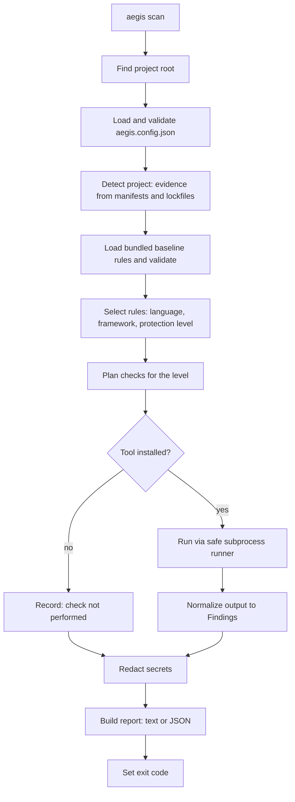

# AEGIS Architecture

Status: design document (Phase 1). Nothing described here as PLANNED exists yet.

## 1. Current repository state (inspected)

- One commit on `main`: tooling and community files only.
- Three placeholder packages (`@aegis/core`, `aegis-engineering`, `@aegis/rules`), each exporting one constant and having one trivial test.
- Passing: lint, format check, typecheck, build, tests (3), clean `npm ci` install.
- Not present: the `.aegis` format, rules, parser, engine, CLI commands, scanner integrations, agent integrations.
- `docs/AEGIS-MASTER-SPEC.md` is referenced by the roadmap and must be added by the maintainer from their local copy.

## 2. Technical constraints found

| Constraint     | Detail                                                                                                                             | Consequence                                                                                                                      |
| -------------- | ---------------------------------------------------------------------------------------------------------------------------------- | -------------------------------------------------------------------------------------------------------------------------------- |
| Runtime        | Sandbox ran Node 22 and npm 10. Node 20 reached end of life in April 2026.                                                         | Support Node 22 and 24 (maintained LTS lines). CI matrix and `engines` updated in this phase.                                    |
| Module system  | ESM with `NodeNext` resolution.                                                                                                    | Relative imports in TypeScript need `.js` extensions.                                                                            |
| Optional tools | Semgrep, Gitleaks and OSV-Scanner were all absent in the sandbox.                                                                  | The engine must treat "tool missing" as a normal, reported state. Tests must use fake executables, not real scanners.            |
| Platforms      | Linux tested only. Windows and macOS path and executable-lookup rules differ.                                                      | Use `node:path`, never build shell strings, resolve executables explicitly. Add a Windows CI job before v1.                      |
| Licensing      | Scanner licenses and rule-pack licenses differ (for example, a scanner's code license may differ from its bundled rules' license). | Verify each license in Phase 5 before bundling or redistributing anything. AEGIS calls installed tools and does not bundle them. |
| Agent features | Claude Code and Copilot configuration features change between versions.                                                            | Phase 6 must read current official docs and mark untested behavior as untested.                                                  |
| Network        | Not required by the core.                                                                                                          | Core works fully offline. Only `aegis rules update` may use the network (Phase 8).                                               |

## 3. Package boundaries

```text
packages/
  core/    parser, schemas, loader, project detection, rule selection,
           findings model, reports, redaction, safe subprocess runner,
           scanner adapters, agent-file generators, learning records, updates
  rules/   bundled baseline rules as DATA files (never code) + their tests
  cli/     thin Commander layer: parses arguments, calls core, prints, sets exit codes
formats/     JSON Schema files generated from the Zod schemas (single source of truth)
(rules/templates)  AEGIS.aegis master file and config template, used by `aegis init` and for manual setup
tests/       cross-package integration tests and isolated vulnerable fixtures
```

Rules for the boundaries:

- `cli` contains no business logic. Anything testable without a terminal lives in `core`.
- `rules` contains data only. It has no executable code beyond a small loader export.
- `core` modules depend downward only: `schemas` -> `parser` -> `loader` -> `selection` -> `engine` -> `reports`. Scanner adapters and integrations depend on `schemas` and the subprocess runner, never on each other.

## 4. Data flow: `aegis scan`



Key property: a skipped or failed check is a first-class result in the report. A missing scanner can never produce a clean-looking report.

## 5. Trust model

| Input                                     | Trusted?                     | Handling                                                                                                |
| ----------------------------------------- | ---------------------------- | ------------------------------------------------------------------------------------------------------- |
| Bundled baseline rules                    | Trusted after release review | Validated by schema at load time anyway.                                                                |
| Downloaded rule updates                   | Untrusted until verified     | Schema validation, compatibility check, signature verification, atomic apply (Phase 8). Never executed. |
| `.aegis` files and project config         | Untrusted                    | Parsed with a safe parser. No evaluation, no includes outside the project root.                         |
| Project source code                       | Untrusted                    | Read only. Never executed by AEGIS. Secret values are not read during detection.                        |
| Scanner output                            | Untrusted                    | Parsed and validated before becoming Findings.                                                          |
| Rule example code (bad and good examples) | Inert text                   | Stored and displayed only. Never evaluated.                                                             |
| Scanner configuration                     | Separate from rule metadata  | A rule may only reference scanners from an allowlist and cannot supply commands.                        |

## 6. Key decisions and reasons

1. **Three packages, not seven.** The spec's proposed layout has separate `rule-validator`, `integrations/claude-code` and `integrations/github-copilot` packages and an `apps/docs` site. Validation is a core function (the CLI and CI both call it), and two small generators do not justify package overhead. Split a module out only when a second consumer needs it. The documentation website is deferred until the core works.
2. **Zod as the single source of truth.** TypeScript types, runtime validation and the published JSON Schema files all derive from the same Zod schemas, so they cannot drift apart.
3. **Rules are data.** Rule files are validated documents. The loader never calls `eval`, dynamic `import`, or a shell for rule content.
4. **Safe subprocess runner.** All external tools run through one module that uses argument arrays (no shell), a fixed working directory, a timeout, and an output size cap. No other module may spawn processes.
5. **Wrap mature scanners, do not rebuild them.** AEGIS adds orchestration, normalization and honest reporting.
6. **Findings carry both severity and confidence,** and a status that distinguishes finding, warning, confirmed failure, tool error, skipped check and unverified suggestion.
7. **Protection levels are configuration,** not separate code paths: standard, advanced and maximum change which rules and checks are selected.
8. **`.aegis` is a restricted YAML 1.2 document** (decided in Phase 2): core schema only, no aliases or custom tags, strict unknown-field rejection, line-numbered diagnostics. Rules are separate YAML files. See `formats/aegis-file-spec.md`.
9. **Minimal dependencies.** Expected runtime dependencies: `zod`, `commander`, and one safe YAML/front-matter parser. Each addition needs a reason.

## 7. Feature status

| Feature                                                                          | Status                                                                                                                                                  |
| -------------------------------------------------------------------------------- | ------------------------------------------------------------------------------------------------------------------------------------------------------- |
| Monorepo, strict TypeScript, lint, tests, CI                                     | Implemented and tested                                                                                                                                  |
| `.aegis` format, schemas, parser                                                 | PLANNED (Phase 2)                                                                                                                                       |
| Starter rule library                                                             | PLANNED (Phase 2)                                                                                                                                       |
| Project detection, selection, findings, reports                                  | PLANNED (Phase 3)                                                                                                                                       |
| CLI commands                                                                     | PLANNED (Phase 4)                                                                                                                                       |
| Scanner integrations (Gitleaks, Semgrep, npm audit, OSV-Scanner, tsc, ESLint)    | Implemented (Phase 5). Tested against real Gitleaks, Semgrep, npm and tsc. OSV-Scanner vulnerable output and ESLint were not verified against real runs |
| Agent integrations (`@aegis/integrations`: Claude Code, Copilot, Codex, ChatGPT) | Implemented (Phase 6). File generation, safe writes and the Claude Stop hook are tested; behavior inside live agent sessions is untested                |
| Learning records                                                                 | PLANNED (Phase 7)                                                                                                                                       |
| Signed rule updates                                                              | PLANNED (Phase 8)                                                                                                                                       |
| Documentation website                                                            | PLANNED (after core works)                                                                                                                              |
